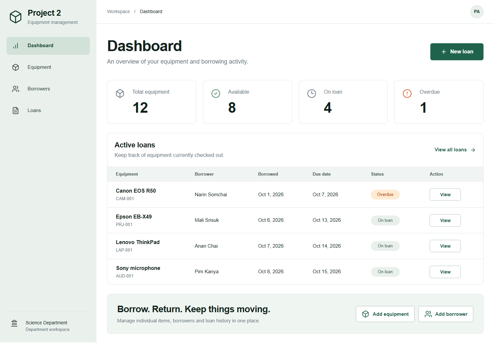
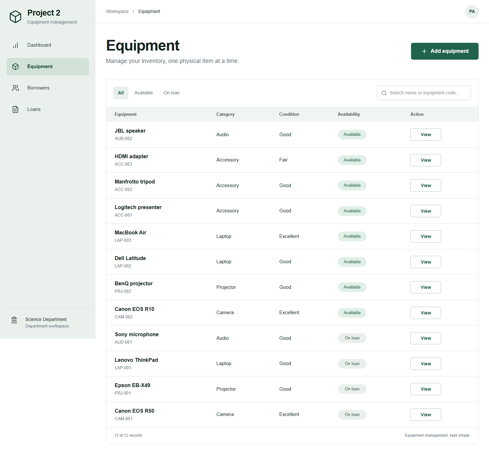
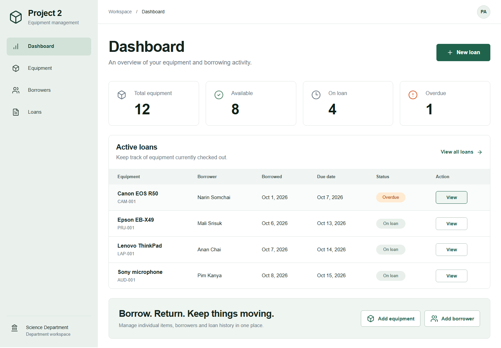
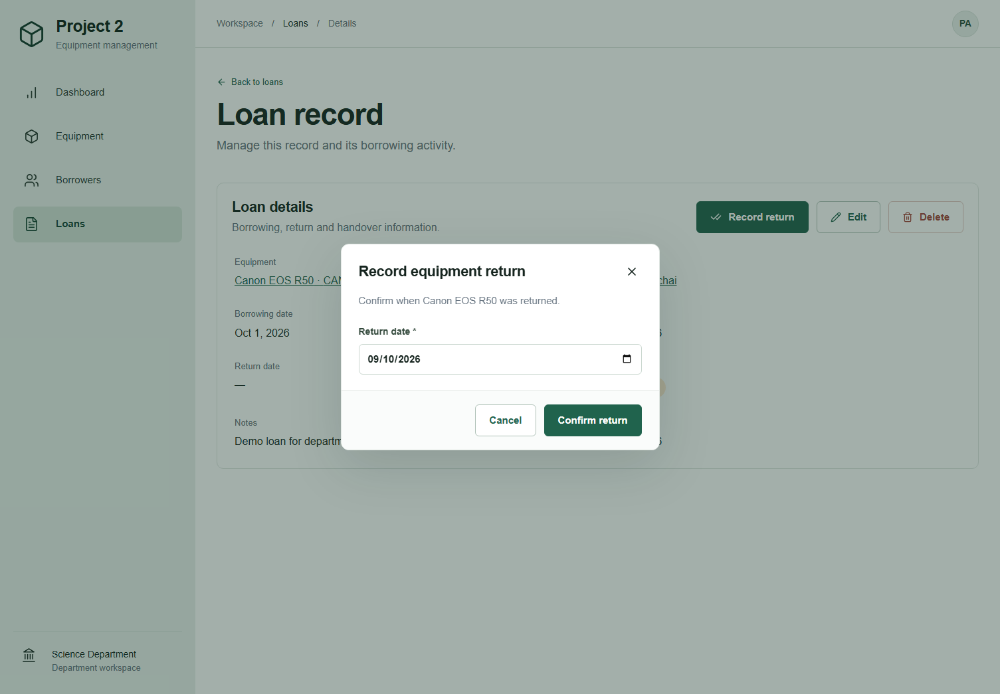
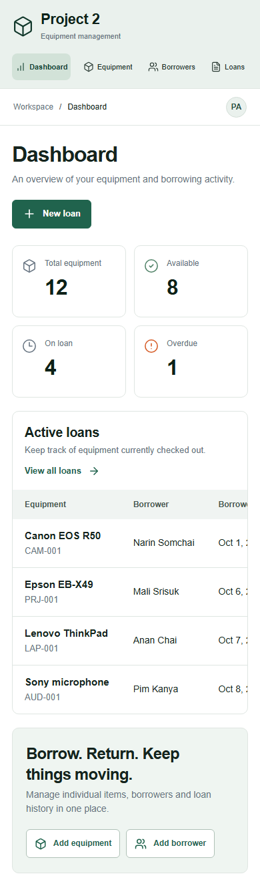

# Project 2: Equipment Borrowing and Return Management System

Project 2 is an original proof of concept for managing shared equipment in a university department or small organization. It brings equipment, borrowers and borrowing history together, with availability, due dates and returns visible in one place.

## Team member

| Name | GitHub |
| --- | --- |
| Pongpisit Arjnarong | [nongfresh8234-cloud](https://github.com/nongfresh8234-cloud) |

Project repository: [nongfresh8234-cloud/project-2](https://github.com/nongfresh8234-cloud/project-2). The source is published from this original project; contribution history reflects actual commits.

## Screenshots

Real browser screenshots with explicitly seeded demo records:







## Features

- Equipment CRUD: unique code, name, category, description, condition and creation date. Search by name or code; filter by availability.
- Borrower CRUD: full name, email, phone, department and creation date. Search and linked loan history.
- Loan CRUD: equipment and borrower references, borrowing date, due date, return date and notes. Record returns, correct records and filter by status.
- Dashboard: total equipment, available equipment, active loans and overdue loans.
- Validation and feedback on forms; accessible delete and return confirmation dialogs.
- Equipment and borrowers with any linked loan history cannot be deleted. Remove an incorrect loan explicitly before deleting an associated record.
- A physical item can have only one active loan. A MongoDB partial unique index enforces this even for simultaneous requests.
- Transactions serialize mutations so a concurrent loan and record deletion cannot create dangling references.

## Required stack

Next.js 16 App Router, React 19, TypeScript, plain CSS, MongoDB 8 using the official Node.js driver. REST APIs use Next.js Route Handlers. Next.js and MongoDB run together on a VM using Docker Compose. No Firebase, managed backend or serverless hosting.

## Run locally on Windows

Install Node.js 24 LTS, open PowerShell in this project, then run:

```powershell
npm ci
npm run dev
```

Open [http://127.0.0.1:3000](http://127.0.0.1:3000). When `MONGODB_URI` is not configured, the development launcher downloads and starts a real local MongoDB binary as a one-node replica set. The first run needs internet access and disk space. Subsequent runs reuse the binary. Data persists under `.local-data/mongo/`; this directory is excluded from Git. This is a development convenience, not a managed backend or browser-only data store.

To use an existing self-hosted MongoDB replica set, copy `.env.example` to `.env.local`, update its connection string, and run `npm run dev`. Transactions require a replica set; a standalone `mongod` is insufficient.

Optional sample records, in a second terminal while the app is running:

```powershell
npm run seed
```

The seed refuses to modify a nonempty database. Production starts empty; demo data is never inserted automatically. Demo borrower emails use the reserved `example.com` domain.

## Live application

[Open Project 2](http://my-server.eastasia.cloudapp.azure.com) · [Deployment record](docs/DEPLOYMENT.md)

The app runs on the owner's Azure Ubuntu VM with self-hosted MongoDB and Docker Compose. It contains synthetic demo records.

## Deploy on an Azure VM

Follow the beginner-friendly [Azure Portal deployment guide (Thai)](docs/AZURE-VM-TH.md). It covers creating an Ubuntu VM, SSH, publishing this source, installing Docker, opening the website and troubleshooting.

On the VM, from this project's directory:

```bash
sudo docker compose up -d --build
sudo docker compose ps
curl http://localhost:3000/api/health
```

By default the application is available at `http://YOUR_VM_PUBLIC_IP:3000` after allowing TCP 3000 in the VM's Azure network rule. Or start with `APP_PORT=80 sudo -E docker compose up -d --build` and allow TCP 80. MongoDB has no published host port. Its data lives in the `mongo_data` Docker volume.

For the proposed academic POC, authentication and role permissions are out of scope. Anyone with network access can manage records. Use demo data on a publicly reachable class demonstration; restrict network access or add authentication before collecting real borrower information.

Do not run `docker compose down -v` unless you intend to erase the database. To stop containers while preserving data, use `sudo docker compose down`.

## REST API

Successful responses are `{ "data": ... }`; errors are `{ "error": "message" }`. Create returns 201; reads, updates and deletes return 200. Invalid input returns 400, missing records 404, conflicts 409 and database problems 503. Unsupported methods return 405.

| Entity | Create | Read list / detail | Update | Delete |
| --- | --- | --- | --- | --- |
| Equipment | `POST /api/equipment` | `GET /api/equipment`, `GET /api/equipment/:id` | `PATCH /api/equipment/:id` | `DELETE /api/equipment/:id` |
| Borrower | `POST /api/borrowers` | `GET /api/borrowers`, `GET /api/borrowers/:id` | `PATCH /api/borrowers/:id` | `DELETE /api/borrowers/:id` |
| Loan | `POST /api/loans` | `GET /api/loans`, `GET /api/loans/:id` | `PATCH /api/loans/:id` | `DELETE /api/loans/:id` |

All list endpoints accept `?q=` for text search. `GET /api/dashboard` returns counts; `GET /api/health` checks the database connection.

Example request bodies:

```json
{"name":"Canon EOS R50","code":"CAM-001","category":"Camera","description":"With battery and charger","condition":"Good"}
```

```json
{"fullName":"Example Borrower","email":"borrower@example.com","phone":"0812345678","department":"Computer Science"}
```

```json
{"equipmentId":"<equipment _id>","borrowerId":"<borrower _id>","borrowingDate":"2026-10-09","dueDate":"2026-10-16","notes":"Coursework"}
```

Use actual IDs and dates appropriate to the current day. Equipment codes are trimmed and converted to uppercase. Condition is one of `Excellent`, `Good`, `Fair`, `Needs repair`. Dates are calendar strings `YYYY-MM-DD`. A due date cannot precede borrowing, borrowing cannot be in the future, and returns must be between borrowing and today. Due dates remain valid for the whole day in `Asia/Bangkok`; overdue means `dueDate < today` with no return date. Availability depends only on active loans, as specified in the proposal. Return with `PATCH /api/loans/:id` and `{ "returnDate": "YYYY-MM-DD" }`; set `returnDate` to `null` to correct/reopen a loan, subject to the active-loan uniqueness rule.

## Validation

Run with the local app running in a separate terminal:

```powershell
npm run typecheck
npm test
npx playwright install chromium
npm run test:ui
```

`npm test` exercises real HTTP APIs backed by MongoDB: CRUD for all entities, malformed inputs, duplicate codes, invalid dates and references, overdue/returned statuses, history protection, simultaneous borrowing and concurrent deletion. `npm run test:ui` creates its own fixtures, verifies the equipment edit and borrowing/return workflow, search and delete protection, then checks seven routes at a mobile viewport. Both test suites clean up their own fixtures. Run tests only on a development/test instance. Set `BASE_URL` to target another test server. Run `npm run build` to validate production compilation; configure `MONGODB_URI` when using `npm start`.

## Project structure

```text
app/                    Pages, layout, CSS and REST Route Handlers
components/             Workspace, lists, details, forms and dialogs
lib/                    MongoDB connection, transactions and domain rules
scripts/                Local database launcher and explicit demo seed
tests/                  API integration and browser workflow tests
docs/                   Proposal, Azure guide, demo script and screenshots
Dockerfile              Standalone Next.js production container
compose.yaml            Next.js + self-hosted MongoDB replica set
```

## Submission

See [the submission checklist and five-minute demo script](docs/SUBMISSION-TH.md) and [the current project proposal](docs/PROPOSAL.md). The Azure VM deployment and public URL are verified; see docs/DEPLOYMENT.md. Proposal submission and YouTube upload are separate remaining submission steps.

Future senior-project extensions: authentication, role permissions, QR scanning, reminders and usage reports. Lists currently load the full dataset; production-scale pagination and performance work are future extensions.
