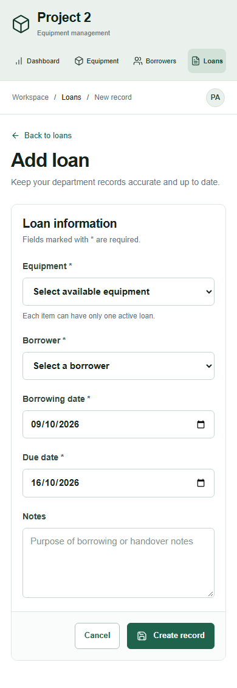

# Project 2 verification — 9 October 2026

## Summary

The application was verified locally against a real MongoDB 8.0.12 replica set, in both Next.js development mode and the built standalone production server. All required REST CRUD endpoints and the main borrowing/return workflow passed. The project was subsequently renamed to Project 2 at the owner’s request and deployed to their existing Azure VM. The full API and UI suites also passed against http://20.255.52.202.

## Environment and method

- Development: `http://127.0.0.1:3000`; standalone production: `http://127.0.0.1:3001`.
- The Codex in-app browser was used first to load the actual dashboard, inspect its accessible content and logs, navigate to Equipment and search `CAM-001`; one matching record remained.
- Its screenshot capture was clipped to the side-panel canvas despite a 1505 × 1045 viewport override. Playwright Chromium was used for reliable full desktop screenshots and automated responsive testing. The separate Browser plugin/skill was not installed; the available IAB was still used first. The temporary IAB viewport override was reset at handoff.
- Playwright viewports: 1505 × 1045 (the concept's native size) and 390 × 844. Full-page screenshots can be taller than the viewport.
- Runtime source reviewed against the installed Next.js Route Handler, deployment, router and dev indicator documentation.

## Changes verified

Workspace navigation, equipment and borrower lists/details/forms, loan lists/details/forms, returns, confirmation dialogs, search/filter states, availability and overdue counters. MongoDB transactions and indexes enforce the domain rules on server writes, independent of the UI.

## Checks

| Check | Result and evidence |
| --- | --- |
| Page identity | PASS: Project 2 title and expected routes in IAB and Chromium |
| Nonblank page | PASS: dashboard metrics, active-loan table and actions loaded from MongoDB |
| Framework overlay | PASS: no compilation/runtime error overlay |
| Console health | PASS: no unexpected errors or uncaught exceptions; a deliberate delete conflict produces an expected HTTP 409, handled by the dialog |
| Screenshot evidence | PASS: dashboard, inventory, loan details, return dialog, mobile dashboard and mobile form inspected |
| Interaction proof | PASS: create equipment → edit → create borrower → create loan → return → item available → search → linked delete rejected |
| Mobile routes | PASS: dashboard, equipment, borrowers, loans and all three create forms; no document-wide horizontal overflow |
| API integration | PASS: 8 tests (parent plus 7 subtests), CRUD for all three entities, validation, active-loan conflicts, returns, history protection, concurrent borrowing and delete/reference races |
| Types / production build | PASS: `npm run typecheck`, `npm run build` |
| Standalone server | PASS: API and browser workflow suites rerun against the generated standalone server |
| Dependencies | PASS: `npm audit` reported zero vulnerabilities at verification time |
| Docker / Azure | PASS: official Docker packages installed on existing Ubuntu VM; Compose build and startup passed, MongoDB/web healthy; external health check and complete API/UI suites passed |

## Design fidelity ledger

Primary concept: `design-concept.png`. Latest rendered reference: `screenshots/dashboard.png`. Both were opened with `view_image` together after the final visual edits; mobile, details and dialog images were also inspected.

| Comparison point | Concept / implementation evidence | Resolution |
| --- | --- | --- |
| Layout | Pale green left rail, topbar, title, four metrics, table, lower action strip | Sidebar adjusted to 294px at native desktop size; matching section order preserved |
| Typography | Large dark title, medium section headings, legible secondary copy | Desktop title and metric sizes increased; table/body/control sizes explicitly defined |
| Palette | White content, forest green controls, gray-green rail, orange overdue | Tokens retained; no cream background, decorative gradients or image overlays |
| Container model | Thin bordered metrics and full-width table; restrained corners | Matched with shared panel/button primitives; no replacement card grid |
| Copy / actions | Dashboard, overview sentence, four metric labels, Active loans caption and four primary links/actions | Above-the-fold copy diff: no unintended additions or omissions; brand renamed from EquipTrack to Project 2 at the owner’s explicit request |
| Icons | Consistent outlined cube, navigation and status motifs | Lucide outline icons; Borrowers uses a two-person metaphor instead of the concept's single-person glyph |
| Data | Concept shows 12 total, 8 available, 4 on loan and 1 overdue | Actual MongoDB demo fixtures produce those values; values update from records rather than being hardcoded |
| Responsive behavior | Same hierarchy at a smaller width | Fixed mobile navigation width overflow; two metric columns, single-column forms, table scrolling confined to its wrapper |

The primary design was faithfully verified against its concept for composition, text, hierarchy, palette, spacing and component treatment. No material visual defects remain in the tested views. Intentional differences: no workspace-switch chevron because there is only one workspace, the two-person Borrowers icon, system-font rendering differences, and live data/date-derived status. Authentication is not implied by the static PA avatar.

## Commands and interaction sequence

`npm run build`, `npm run typecheck`, `npm test`, `npm run test:ui`, `npm audit`. Screenshot capture is opt-in with `CAPTURE_SCREENSHOTS=1`. Browser calls used the IAB tab's `getAXState`, semantic locators, screenshot and log APIs; Playwright tests are in `tests/ui.test.mjs`.

The full UI loop created temporary equipment and borrower records, edited equipment details, created a loan through the available-item selector, submitted a return date, observed Returned and Available, searched by unique code and checked that deletion with history returns visible feedback. All temporary test fixtures were removed using their own saved IDs. README screenshots use named demo records rather than test IDs.

## Remaining limits

Azure/Docker runtime and public production URL are now verified. GitHub publication is part of this continuation; YouTube upload is still pending. Chromium desktop/mobile was tested; Safari, Firefox and real-device testing remain. Authentication/roles, HTTPS configuration and large-dataset pagination are outside this POC. Test data is intentionally synthetic. Local production-mode checks do not substitute for deployment on the required VM.

## Screenshots

Latest VM evidence: `http://my-server.eastasia.cloudapp.azure.com/api/health` returned status ok. Screenshot files were refreshed from the deployed site after the approved Project 2 rename. No new VM or network rule was created. Existing VM is Spot; availability should be checked before assessment.
